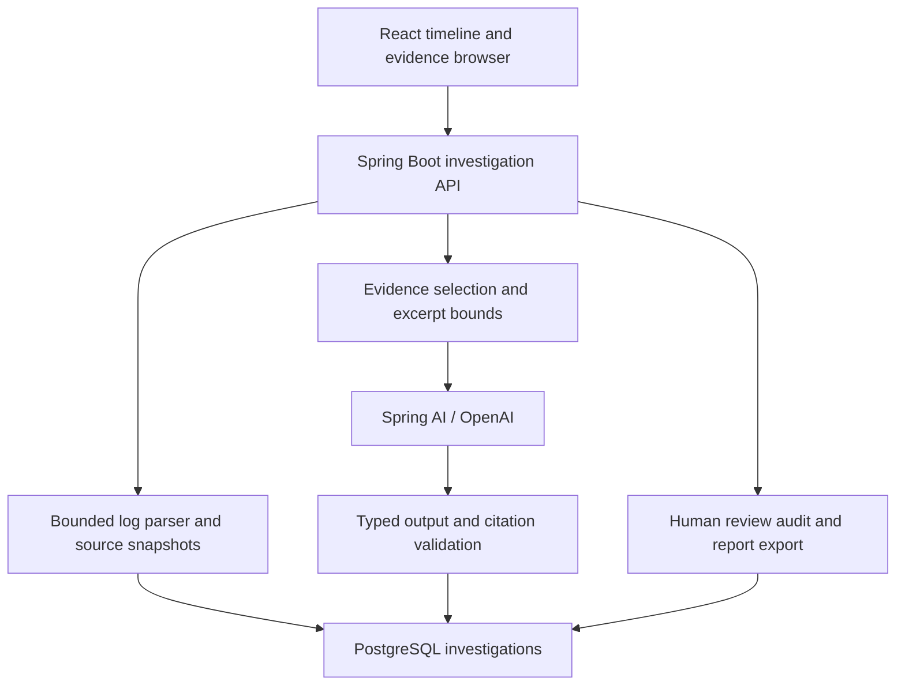

# AI Incident Investigation Workbench

An evidence-first workspace for investigating failures across services. Import logs, reconstruct an incident timeline, follow trace IDs, inspect original source lines and ask Spring AI/OpenAI for hypotheses linked to selected evidence. Record your review decisions and export the investigation.

The application does not monitor systems or fix them automatically. It works on immutable uploaded log snapshots. AI suggestions remain unconfirmed; engineers decide what to investigate next.

## Start the complete application

Requires Docker Desktop or Docker Engine with Compose. Python 3 enables automatic first-launch port selection.

```bash
bash start.sh
```

Open the address printed by the script, normally **http://localhost:53493**. Click **Explore sample incident**. No API key is needed to import logs, browse the timeline, filter evidence, inspect sources, resolve investigations or export reports.

| Service | Default address |
|---|---|
| Workbench | http://localhost:53493 |
| API | http://localhost:58493/api/incidents |
| Health | http://localhost:58493/actuator/health |
| PostgreSQL | localhost:55493 |

First launch selects available ports near these defaults and writes `.env`. Later launches preserve that file, including your API key. Exported shell variables override `.env` under standard Compose rules. Port selection is best-effort: the final Docker bind is authoritative. If an existing `.env` port becomes occupied, edit that port manually.

Without Python, copy `.env.example` to `.env`, adjust ports if needed, and run `docker compose up --build -d`. First build downloads dependencies, runs backend/frontend tests and builds the React application. The frontend can appear before the API is ready; use **Retry connection** after Spring Boot starts.

```bash
docker compose logs -f backend
docker compose down
```

All exposed ports bind to loopback. The project has its own Compose network and database volume, so other portfolio projects can remain running. This is a trusted local single-instance app with no authentication.

## Enable real AI analysis

1. Create an API key in your OpenAI API account: https://platform.openai.com/api-keys
2. Open the local `.env` created by `start.sh` and set:

```dotenv
OPENAI_API_KEY=your-local-api-key
OPENAI_MODEL=gpt-4.1-mini
```

3. Recreate the backend to apply the environment:

```bash
docker compose up -d --no-deps backend
```

4. Refresh the dashboard. The assistant will show **CONFIGURED**. This indicates a nonblank key is present, not that credentials, billing or model permissions have already been verified.
5. Click **Preview AI evidence**, review the excerpts, optionally add a focus question, then click **Send evidence to OpenAI**.

`.env` is Git-ignored. Keep the key on your machine; do not paste it into chat or commit it. API usage is billed separately from ChatGPT. The default model uses Chat Completions with temperature and max-token options; changing it requires a model that supports those options and structured text output.

**Data sent:** investigation title, optional question, selection metadata and up to 60 evidence excerpts with timestamps, service, level, trace ID, evidence ID and source filename/line. Message excerpts are clipped to 300 characters plus a clipping marker. Raw original lines and full files are not sent. There is no automatic secret redaction: preview the selection and use logs you intend to share with OpenAI. Importing alone never calls the model.

## Explore the sample

The sample is a synthetic fixture, clearly separate from a live system. Its 34 records across Order, Inventory and Payment contain:

- Service startup and a payment processor configuration record.
- Three checkouts followed by processor connection timeouts.
- Order cancellations and recorded inventory reservation releases.
- A process health result that differs from dependency health.

The logs show symptoms and timing. They do **not** prove which configuration was previously correct, whether DNS/network/firewall changes occurred or whether the processor was available. A useful AI result should preserve that uncertainty.

Try:

1. Click an error marker in the timeline to open its evidence and original source context.
2. Search `SocketTimeoutException`; there are three matching records.
3. Click a trace link to isolate one request across services.
4. Check a few evidence boxes, then preview the exact selection for analysis. Clear the selection to use automatic selection.
5. With AI configured, generate an analysis, inspect citation links and accept/reject a hypothesis with review notes.
6. Open **Saved reports** and export Markdown, JSON or CSV.
7. Set the investigation status to **Resolved**, refresh, and reopen it.

The deterministic **Observed patterns** panel groups imported ERROR/FATAL messages with normalized order identifiers. It is labelled **NO AI USED** and makes no root-cause claims. It displays the first message in each group and the actual occurrence count, not an invented diagnosis.

## Supported log formats

Use **New investigation**, enter a title and select one or more `.log`, `.txt` or `.jsonl` files. There is no ZIP import or arbitrary parser auto-detection in V1. Files are read as data, never executed.

### Plain text

One event per nonblank line:

```text
2026-10-18T14:02:23Z ERROR [payment] [trace=req-a01] Processor connection timed out
2026-10-18T15:02:24+01:00 WARN [order] Order cancelled
```

Required: ISO offset timestamp, uppercase level, bracketed service, message. `[trace=...]` is optional. Valid levels: TRACE, DEBUG, INFO, WARN, ERROR, FATAL. Service names contain letters, digits, `_`, `.` or `-` and are at most 60 characters. Trace IDs are at most 100 characters; messages at most 6000.

### JSONL

One JSON object per line:

```json
{"timestamp":"2026-10-18T14:02:23Z","service":"payment","level":"ERROR","traceId":"req-a01","message":"Processor connection timed out"}
```

Required fields are strings: `timestamp`, `service`, `level`, `message`; `traceId` is optional. Use actual UTC offsets rather than guessing timezones. Naive timestamps without an offset are rejected.

Bundled examples are in `samples/` and identically packaged in the backend resources for the sample button.

### Import bounds and diagnostics

| Limit | Value |
|---|---|
| Files per import | 1–6 |
| Each file | 1 MiB |
| Combined file bytes | 3 MiB |
| Multipart request | 4 MiB |
| Nonblank lines, including rejected lines | 4000 |
| Characters per line | 8192 |
| Distinct parsed services | 12 |
| Displayed import diagnostics | First 100 |

Input must be UTF-8; a leading BOM is accepted. Use unique, case-insensitively distinct plain filenames ending in lowercase `.log`, `.txt` or `.jsonl`, with no directory paths. Unsupported lines, malformed records and overlong lines are counted as rejected and retained in original source text. At least one record must parse; otherwise nothing is saved. Files or imports that exceed aggregate bounds are rejected in full.

Coverage is visible: a partial import shows a warning and per-file parsed/rejected counts. Rejected records do not appear on the timeline or get sent to AI. The importer does not join multiline stack traces; convert them to a JSONL message string or retain them as rejected source lines for manual inspection.

Parsed timestamps normalize to UTC and sort chronologically; identical timestamps retain upload-file/line order. IDs `E0001`, `E0002`, etc. are assigned within that imported snapshot and never change. Clock skew is not corrected; timestamp order is not proof of causality or distributed happens-before relationships.

## AI context and review guarantees

An explicit selection includes up to 60 distinct evidence IDs from the current incident. With no selection, the backend fills up to 60 slots by scanning ERROR/FATAL records with one chronological neighbor on each side, then WARN records, then earliest remaining records. The result is returned in chronological order. Early error neighborhoods can fill the limit before later errors are included; inspect and focus the selection when necessary.

Spring AI's `ChatClient` sends the bounded context and maps output to typed Java records. The prompt treats logs as untrusted data, asks for 1–3 unconfirmed hypotheses, cited evidence, next checks and limitations. The backend validates output structure, text/list bounds and every citation against the **actual context sent**. Unknown, duplicated or out-of-selection citation IDs reject the entire response. No failed result is saved as a successful analysis.

Citation validation establishes that references exist in the supplied context. It does not establish that a cited line supports an inference. AI may still misinterpret logs or follow adversarial text despite prompt instructions. The UI renders returned text as text, not HTML, and offers no command execution, remediation, external fetching or tool calling.

Only one AI request runs at a time per backend instance; competing analyses receive **429**. The HTTP client uses 10-second connection and 60-second read timeouts, 1800 maximum output tokens and one attempt with no automatic retries. Those are transport timeouts, not a total end-to-end deadline including DNS. A failed or invalid response returns **502** with an actionable generic message; a missing key returns **503**. Client disconnection does not guarantee provider cancellation or prevent a charge.

Human reviews are append-only. Accepting or rejecting a hypothesis records the decision, notes and server timestamp; the latest timestamp/ID order determines the displayed decision. Earlier reviews remain in the audit history. Acceptance is not relabelled as a verified root cause. Investigation OPEN/RESOLVED status is a separate manual decision.

## Architecture



| Component | Responsibility |
|---|---|
| `LogImporter` | Format validation, timestamp normalization, coverage diagnostics and stable evidence IDs |
| `EvidenceContext` | Deterministic selection and message clipping |
| `OpenAiAnalyst` | Spring AI ChatClient, provider configuration and structured output |
| `InvestigationService` | Analysis admission, citation validation and human reviews |
| `WorkbenchStore` | Parameterized JDBC persistence and append-only review history |
| `Exports` | Markdown investigation register and CSV formatting |
| React | Timeline, filters, pagination, source inspection, preview, reviews and exports |

Imported incidents are immutable; the workflow creates new snapshots rather than appending live records. Full source text is persisted locally. No embeddings, vector database, hidden RAG corpus or autonomous agent is involved; the selected evidence is explicit.

## API

| Method | Path | Purpose |
|---|---|---|
| GET | `/api/config` | Key-present flag, model and limits; never returns the key |
| GET | `/api/incidents` | Latest 50 summaries |
| POST | `/api/incidents` | Multipart: `title`, repeated `files` |
| POST | `/api/incidents/sample` | Parse and save the bundled sample |
| GET | `/api/incidents/{id}` | Source snapshot, latest 10 analyses and review history |
| POST | `/api/incidents/{id}/context` | Preview selected evidence; body `{"evidenceIds":[]}` |
| POST | `/api/incidents/{id}/analyses` | Analyze; body `{"evidenceIds":[],"question":""}` |
| POST | `/api/incidents/{id}/reviews` | Append a review of a saved hypothesis |
| PUT | `/api/incidents/{id}/status` | Set `{"status":"OPEN"}` or `{"status":"RESOLVED"}` |
| GET | `/api/incidents/{id}/report.md` | Markdown report with evidence register and latest reviews |
| GET | `/api/incidents/{id}/export.json` | JSON snapshot including original sources and latest 10 analyses |
| GET | `/api/incidents/{id}/evidence.csv` | Parsed evidence export |

```bash
curl -i -X POST http://localhost:58493/api/incidents \
  -F 'title=Checkout investigation' \
  -F 'files=@samples/order.log' \
  -F 'files=@samples/inventory.log' \
  -F 'files=@samples/payment.jsonl'
```

Use the actual API port from `.env` if automatic selection changed it.

## Persistence and development

Flyway manages PostgreSQL tables for incident snapshots, analyses and review decisions. Rejected imports and failed AI results are not saved. Incident lists show 50 summaries; incident views and exports include the latest 10 analyses. Older analysis rows remain stored but are outside the incident view/export window. Review history is retained and returned, including reviews of older analyses. There is no automatic retention or delete UI in V1.

```bash
# Preserve investigations:
docker compose down
# Restart with the same data:
docker compose up -d
```

**`docker compose down -v` deletes this application's database, logs, analyses and review history.**

For host-based development: Java 21, Maven 3.9+, Node 24, and Docker for PostgreSQL.

```bash
# Project root
docker compose up -d db

# Terminal 1
cd backend
mvn spring-boot:run

# Terminal 2, from project root
cd frontend
npm ci
npm run dev
```

Open http://localhost:5173. Vite proxies `/api` to localhost:8080. Default database URL is `jdbc:postgresql://localhost:55493/workbench`, user/database `workbench`, development password `workbench_dev`. Override `DB_URL`, `DB_USER`, `DB_PASSWORD` if needed. If startup selected a different database port, use that port in `DB_URL`. Host Maven runs do not automatically read the root `.env`; supply `OPENAI_API_KEY` through your shell/IDE environment when enabling AI outside Compose.

## Verification and boundaries

```bash
mvn -B -f backend/pom.xml verify
npm ci --prefix frontend
npm test --prefix frontend
npm run build --prefix frontend
```

GitHub Actions runs those checks on pushes and pull requests. See [executed verification](docs/VERIFICATION.md) for test evidence and checks still needed on the target machine.

This is a local investigation tool, not a live monitoring system, observability backend or automated remediation agent. It does not infer architecture, ingest arbitrary log formats, correct clock skew or prove root causes. The first version provides a complete import → inspect → select → analyze → review → export workflow. Google Fonts are optional and fall back to system fonts; Lucide supplies interface icons.
